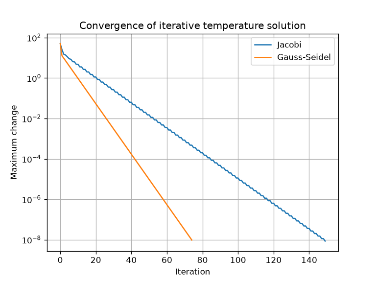

# Task 8: Iterative Methods for Linear Systems

Author: Kelvin Mein

## B. Inputs and mathematical operations
Inputs: 5x5 tridiagonal matrix A (2 on the diagonal, -1 on the neighbours), boundary vector b = [100, 0, 0, 0, 20], tolerance 1e-8.
Operations: Jacobi and Gauss-Seidel iterations, stopped when the maximum change between iterations falls below the tolerance, then compared with np.linalg.solve.

**Output (code/Task_08_iterative_linear.py):**
```
Jacobi temperatures: [86.66666665 73.33333331 59.99999997 46.66666664 33.33333332]
Gauss-Seidel temperatures: [86.66666665 73.3333333  59.99999997 46.66666665 33.33333332]
Direct solution: [86.66666667 73.33333333 60.         46.66666667 33.33333333]
Jacobi iterations: 150
Gauss-Seidel iterations: 75
```



## C. Parameter change and effect
Changed the tolerance from 1e-8 to 1e-4 (code/Task_08_modified_parameter.py).

| | Tolerance 1e-8 | Tolerance 1e-4 |
|---|---|---|
| Jacobi iterations | 150 | 86 |
| Gauss-Seidel iterations | 75 | 43 |
| Jacobi, first temperature | 86.66666665 |