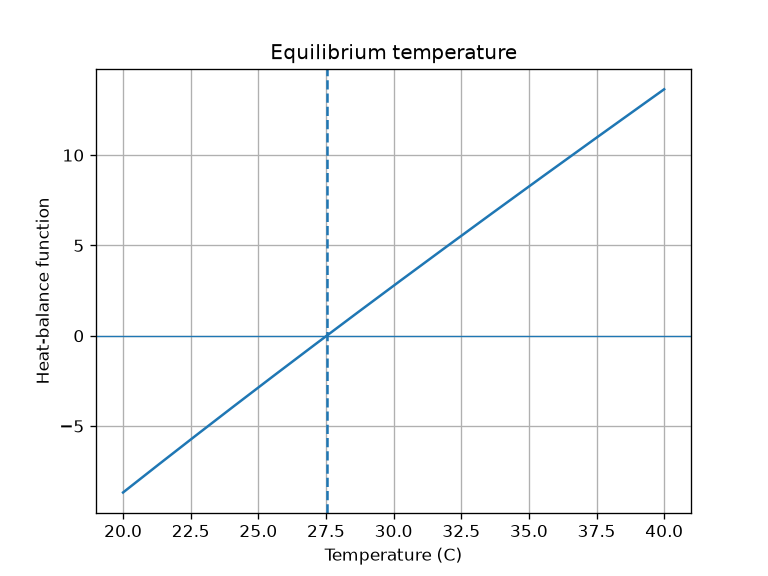

# Task 10: Root Finding: Bisection and Fixed-Point Methods

Author: Kelvin Mein

## B. Inputs and mathematical operations
Inputs: the heat-balance function f(T) = T - 25 - 10e^(-T/20), a bracket [20, 40] with a sign change, tolerance 1e-10, and for fixed-point the rewritten form T = g(T) = 25 + 10e^(-T/20) with start T = 30.
Operations: bisection repeatedly halves the bracket and keeps the half where the sign changes. Fixed-point iteration repeats T_new = g(T) until the change is below 1e-10.

**Output (code/Task_10_bisection_fixed_point.py):**
```
Bisection equilibrium temperature: 27.525211 C
Fixed-point equilibrium temperature: 27.525211 C
Fixed-point iterations: 13
Bisection function evaluations: 40
```



## C. Parameter change and effect
Changed the coefficient 10 to 30 in the heat-balance model (code/Task_10_modified_parameter.py).

| | Coefficient 10 | Coefficient 30 |
|---|---|---|
| Equilibrium temperature | 27.525211 C | 31.279175 C |
| Fixed-point iterations | 13 | 22 |
| Bisection evaluations | 40 | 40 |

A stronger heat effect raised the equilibrium temperature by about 3.75 C. Fixed-point iteration needed more steps (22 instead of 13) because its error shrinks by a factor of about |g'(T)| per step, and |g'| = 1.5e^(-T/20) is about 0.31 here against 0.126 before. Bisection stayed at 40 evaluations because it depends only on the bracket width and the tolerance, not on the shape of the function.

## D. Interpretation
The root of f(T) is the temperature at which heat gain equals heat loss, so the system settles at about 27.53 C. Check: 10e^(-27.525/20) = 2.525, and 25 + 2.525 = 27.525. Both methods give the same answer to 6 decimals. Bisection is slow but guaranteed to work once the sign change is bracketed: each step halves the interval, and about 38 halvings take a width of 20 down to 1e-10. Fixed-point iteration was faster here (13 steps) because |g'(T)| is well below 1, which is the condition for convergence. If |g'| were above 1, the iteration would diverge. On the graph, the curve crosses zero at the dashed line, which marks the equilibrium.

## E. Modified program: break-even point of a small business
Code: code/Task_10_modified_breakeven.py

Assumptions: price 50 KES per unit; cost = 2000 + 20q + 0.01q^2 (fixed cost, unit cost and a rising cost from overtime); profit f(q) = 30q - 0.01q^2 - 2000.

**Output:**
```
Lower break-even (bisection): 68.2179 units
Upper break-even (bisection): 2931.7821 units
Lower break-even (fixed-point): 68.2179 units after 9 iterations
Output with maximum profit: 1500 units, profit = 20500.00 KES
```

The business makes a profit only between about 68 and 2932 units. Below 68 units the fixed cost is not covered, and above 2932 units the rising cost removes the margin. The maximum profit of 20,500 KES occurs at 1500 units, halfway between the two roots. This agrees with the hand solution of 0.01q^2 - 30q + 2000 = 0, which gives q = (30 +/- sqrt(820))/0.02. Bisection found each root by bracketing a sign change, and fixed-point found the lower root in 9 iterations because |g'(q)| = 0.0007q is only about 0.05 near q = 68.