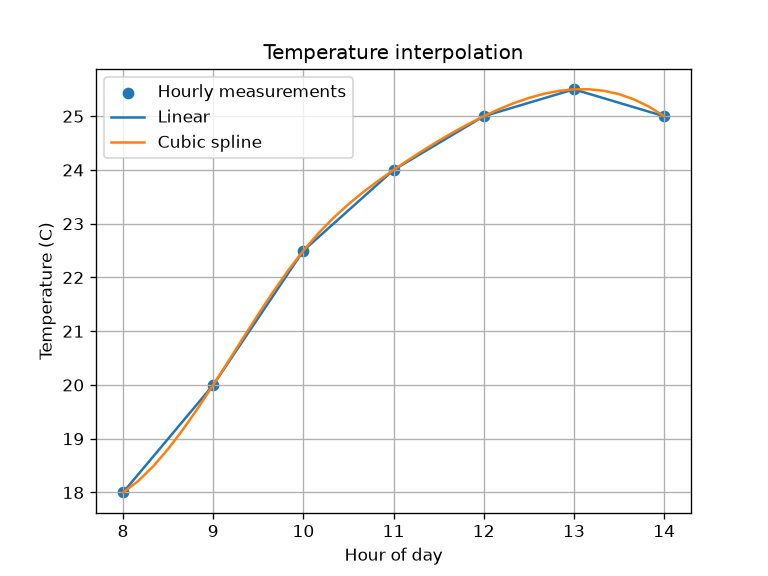
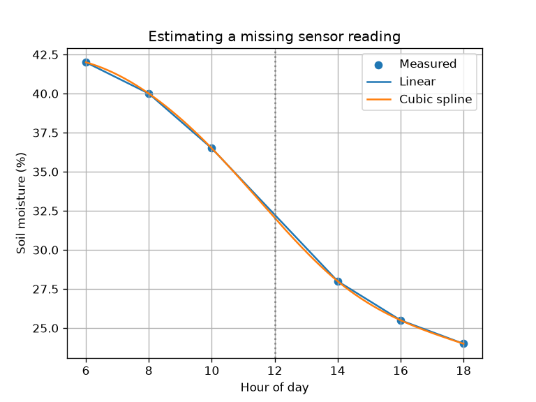

# Task 13: Interpolation

Author: Kelvin Mein

## B. Inputs and mathematical operations
Inputs: hourly temperature readings at hours 8 to 14 (18.0, 20.0, 22.5, 24.0, 25.0, 25.5, 25.0 C), and target times every 10 minutes (1/6 hour).
Operations: interp1d with kind="linear" joins neighbouring points with straight lines. CubicSpline joins them with smooth cubic pieces whose slopes and curvature match at each point. Both are evaluated at 10:30 and at every 10 minutes.

**Output (code/Task_13_interpolation.py):**
```
Linear estimate at 10:30: 23.25 C
Cubic estimate at 10:30:  23.36 C
```



## C. Parameter change and effect
Changed the 11:00 reading from 24.0 to 27.0, a sudden warm spike (code/Task_13_modified_parameter.py).

| | 11:00 reading 24.0 | 11:00 reading 27.0 |
|---|---|---|
| Linear at 10:30 | 23.25 C | 24.75 C |
| Cubic at 10:30 | 23.36 C | 25.18 C |
| Cubic minus linear | 0.11 C | 0.43 C |

Linear interpolation at 10:30 uses only the two neighbouring readings, so it moved by exactly half of the 3.0 C change (1.5 C). The cubic spline uses all points to keep the curve smooth, so the spike bent the curve over a wider region and its estimate rose by more (1.82 C). The gap between the two methods grew from 0.11 C to 0.43 C. Linear is safer for spiky or noisy data, and cubic is better for smoothly varying data.

## D. Interpretation
Interpolation estimates values between measurements. At 10:30 the linear estimate of 23.25 C is simply the average of the 10:00 and 11:00 readings. The cubic estimate of 23.36 C is slightly higher, because the temperature curve is concave here: it rises by 2.5 C, then 1.5 C, then 1.0 C per hour, so the true curve bulges above the straight line between points. The graph shows both curves passing through every measured point, with the spline smooth and the linear curve made of straight segments with corners. This lets an application that needs readings every 10 minutes work from hourly data, as long as the temperature changes gradually.

## E. Modified program: missing soil-moisture reading
Code: code/Task_13_modified_missing_data.py

Assumptions: soil moisture is logged every 2 hours at hours 6, 8, 10, 14, 16 and 18, and the 12:00 reading is missing; moisture falls during the day as the soil dries and changes smoothly.

**Output:**
```
Hour 12: linear = 32.25 %, cubic = 32.05 %
Hour 15: linear = 26.75 %, cubic = 26.56 %
Cubic extrapolation at hour 20: 22.53 % (not reliable)
```



The missing 12:00 reading is estimated at 32.25 % by linear interpolation and 32.05 % by the cubic spline, and at 15:00 the estimates are 26.75 % and 26.56 %. The cubic values are about 0.2 % lower, because the moisture curve is convex: it falls quickly between hours 10 and 14 and then flattens, so the smooth curve sags below the straight chord. There is no true value to compare with, so we cannot say which estimate is more accurate, only that they agree within about 0.2 %. Both assume smooth change across the 4-hour gap, so an event such as rain would not be captured. The value at hour 20 lies beyond the last measurement, so it is extrapolation: the spline simply continues its trend, and nothing in the data supports it. Interpolation is reliable between known points, not outside them.