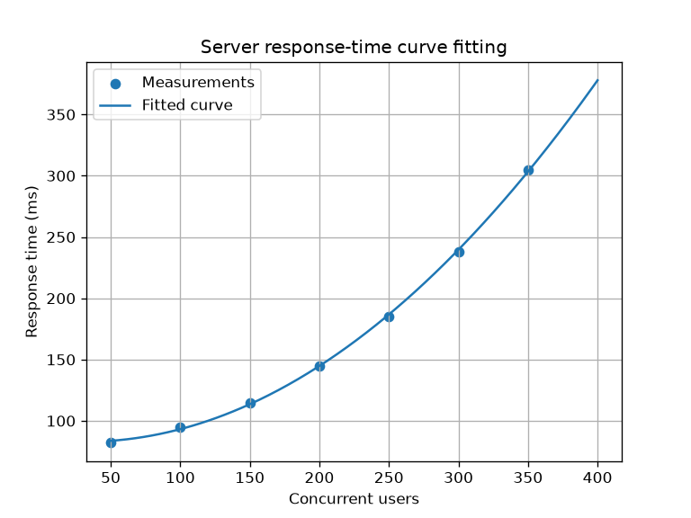
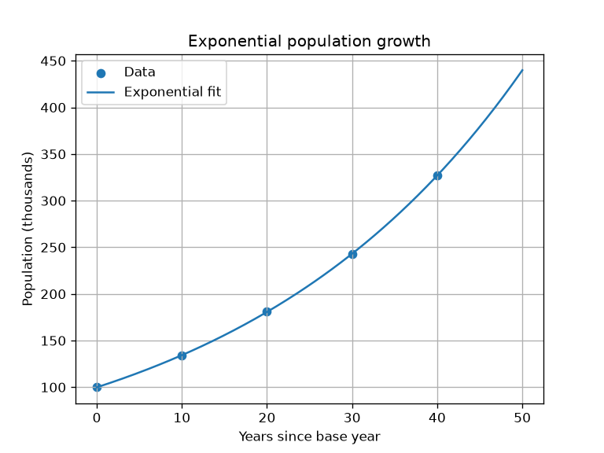

# Task 14: Curve Fitting and Approximation

Author: Kelvin Mein

## B. Inputs and mathematical operations
Inputs: server response times (ms) measured at 50 to 350 concurrent users, and a quadratic model y = ax^2 + bx + c.
Operations: scipy.optimize.curve_fit chooses a, b and c to minimise the sum of squared residuals (least squares). The fit is judged by the RMSE, the square root of the mean squared residual, and used to predict the response at 400 users.

**Output (code/Task_14_curve_fitting.py):**
```
Fitted model: y = 0.002167x^2 + -0.1345x + 85.00
RMSE: 1.55 ms
Predicted response at 400 users: 377.86 ms
```



## C. Parameter change and effect
Changed the model degree to 1 (line), 2 (quadratic) and 3 (cubic) using np.polyfit (code/Task_14_modified_parameter.py).

| Degree | RMSE | Prediction at 400 users |
|---|---|---|
| 1 | 18.83 ms | 312.86 ms |
| 2 | 1.55 ms | 377.86 ms |
| 3 | 0.14 ms | 387.86 ms |

A straight line cannot follow data that curve upward, so its error is large (18.83 ms) and it underpredicts. The quadratic cuts the error by more than ten times. The cubic lowers it further, but with only 7 points and 4 parameters it begins to fit noise rather than the trend. Degree 2 reproduces the original result exactly, which confirms the two programs agree. The predictions at 400 users range from 313 to 388 ms, because they are extrapolation, and the choice of model matters most outside the data. A lower RMSE on known points does not prove a better prediction beyond them.

## D. Interpretation
The fitted curve says response time grows faster and faster as users increase, so the server degrades under load. The quadratic term 0.002167 x^2 dominates at high load. Check at 200 users: 0.002167(40000) - 0.1345(200) + 85 = 144.8 ms, against 145 measured. The RMSE of 1.55 ms means the curve is on average within about 1.5 ms of each measurement. The prediction of 377.86 ms at 400 users is an estimate beyond the last measurement (350 users), so it is only reliable if the same behaviour continues. The graph shows the curve passing close to every point.

## E. Modified program: exponential population growth
Code: code/Task_14_modified_growth.py

Assumptions: population (in thousands) measured at years 0, 10, 20, 30 and 40 since a base year, growing at a roughly constant percentage rate, so the model is P = P0 e^(rt).

**Output:**
```
Fitted model: P = 99.87 * exp(0.02965 t)
Growth rate: 2.965 % per year
Doubling time: 23.38 years
RMSE: 0.212 thousand
Prediction at year 50: 439.9 thousand
```



The fit gives a growth rate of about 2.97% per year, and a starting population of 99.87 thousand, close to the observed 100. Each 10 years multiplies the population by e^(0.2965) = 1.345, which agrees with the data (134 / 100 = 1.34). The doubling time is ln 2 / r = 23.38 years. The RMSE of 0.21 thousand on values of 100 to 327 shows the exponential model fits very well. The prediction of 439.9 thousand at year 50 is extrapolation, and it holds only if the growth rate stays constant, which real populations rarely do over long periods because of limits on resources.