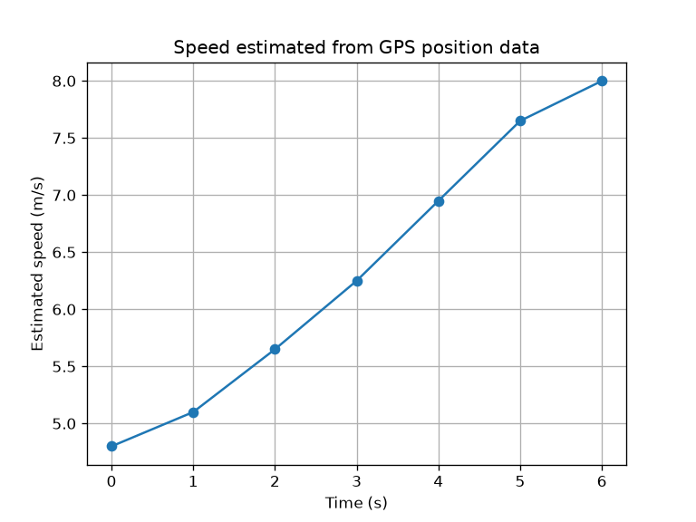
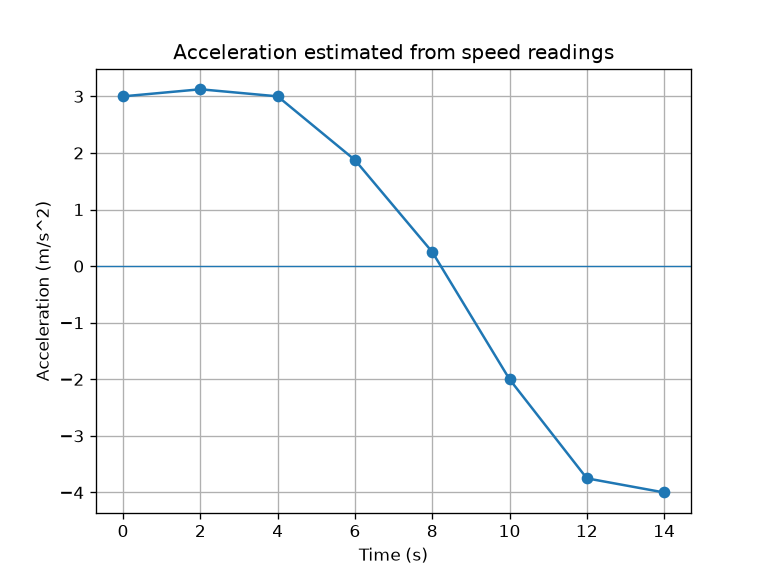

# Task 15: Numerical Differentiation

Author: Kelvin Mein

## B. Inputs and mathematical operations
Inputs: GPS position (m) at times 0 to 6 s, one sample per second.
Operations: speed is the derivative of position. A forward difference [f(t+h) - f(t)]/h is used at the first point, central differences [f(t+h) - f(t-h)]/(2h) at interior points, and a backward difference at the last point.

**Output (code/Task_15_numerical_differentiation.py):**
```
t=0s, position=0.0m, estimated speed=4.80m/s
t=1s, position=4.8m, estimated speed=5.10m/s
t=2s, position=10.2m, estimated speed=5.65m/s
t=3s, position=16.1m, estimated speed=6.25m/s
t=4s, position=22.7m, estimated speed=6.95m/s
t=5s, position=30.0m, estimated speed=7.65m/s
t=6s, position=38.0m, estimated speed=8.00m/s
```



## C. Parameter change and effect
Varied the step size h when differentiating sin(x) at x = 1, where the exact derivative is cos(1) = 0.5403023059 (code/Task_15_modified_parameter.py).

| h | Forward error | Central error |
|---|---|---|
| 0.5 | 2.28e-01 | 2.22e-02 |
| 0.1 | 4.29e-02 | 9.00e-04 |
| 0.01 | 4.22e-03 | 9.00e-06 |
| 0.001 | 4.21e-04 | 9.01e-08 |
| 1e-06 | 4.21e-07 | 2.77e-11 |
| 1e-10 | 5.85e-08 | 5.85e-08 |
| 1e-14 | 3.71e-03 | 3.71e-03 |

The forward error falls in proportion to h (first order): each tenfold cut in h cuts the error about tenfold. The central error falls in proportion to h squared (second order): each tenfold cut in h cuts it about a hundredfold. At h = 0.001 the central difference is about 4,700 times more accurate. For very small h the errors rise again, because subtracting two nearly equal numbers loses digits (round-off, as in Task 4) and dividing by a tiny h magnifies the loss. So there is an optimal step size, and the smallest h is not the best.

## D. Interpretation
The speed rises from about 5 m/s to 8 m/s over 6 seconds, so the vehicle is accelerating, at an average of (8.00 - 4.80)/6, about 0.53 m/s squared. Interior values use central differences, for example at t=3: (22.7 - 10.2)/2 = 6.25 m/s, which is more accurate than the one-sided differences at t=0 and t=6. Real GPS positions contain noise, and differentiation amplifies noise, so small step sizes on noisy data can give erratic speeds. The graph shows a smooth upward trend.

## E. Modified program: acceleration from speed readings
Code: code/Task_15_modified_acceleration.py

Assumptions: a vehicle sensor records speed in m/s every 2 seconds; acceleration is estimated with np.gradient, which uses central differences inside and one-sided differences at the ends.

**Output:**
```
t=   0 s, speed=  0.0 m/s, acceleration=  3.00 m/s^2
t=   2 s, speed=  6.0 m/s, acceleration=  3.12 m/s^2
t=   4 s, speed= 12.5 m/s, acceleration=  3.00 m/s^2
t=   6 s, speed= 18.0 m/s, acceleration=  1.88 m/s^2
t=   8 s, speed= 20.0 m/s, acceleration=  0.25 m/s^2
t=  10 s, speed= 19.0 m/s, acceleration= -2.00 m/s^2
t=  12 s, speed= 12.0 m/s, acceleration= -3.75 m/s^2
t=  14 s, speed=  4.0 m/s, acceleration= -4.00 m/s^2
Strongest acceleration: 3.12 m/s^2 at t = 2 s
Strongest braking: -4.00 m/s^2 at t = 14 s
```



The car accelerates at about 3 m/s squared for the first 4 seconds, the acceleration then fades to almost zero near t=8 s where the speed peaks at 20 m/s, and after that it turns negative as the car brakes. The acceleration crosses zero where the speed is at its maximum, as expected for a derivative. The strongest braking, -4.00 m/s squared, is at t=14 s, but that is an end point using a one-sided difference, so it is less reliable than the interior values. The strongest braking among interior points is -3.75 m/s squared at t=12 s.