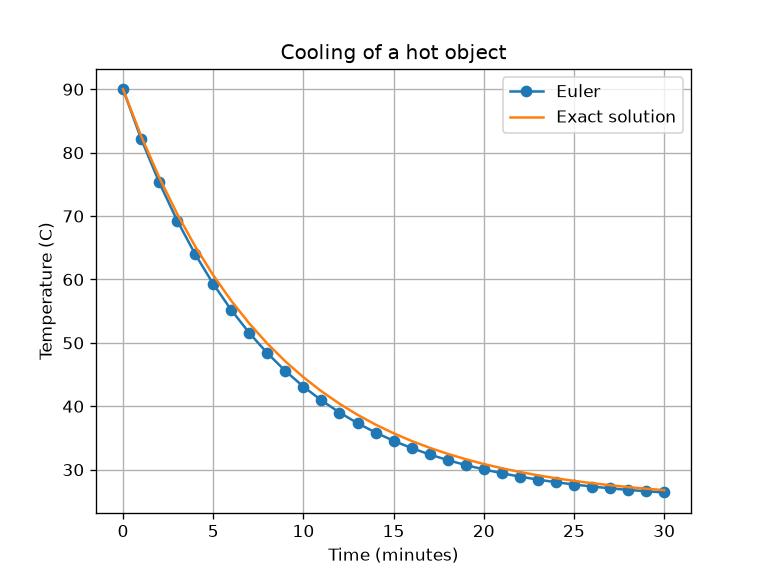
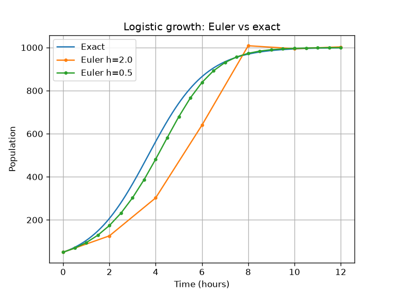

# Task 17: Ordinary Differential Equations, Euler Method

Author: Kelvin Mein

## B. Inputs and mathematical operations
Inputs: Newton's law of cooling dT/dt = -k(T - T_ambient) with T_ambient = 25 C, initial temperature 90 C, k = 0.12 per minute, step size h = 1 minute, end time 30 minutes.
Operations: Euler's method repeats T_next = T + h x f(T), where f(T) = -k(T - T_ambient). The result is compared with the exact solution T = 25 + 65 e^(-kt).

**Output (code/Task_17_euler_ode.py):**
```
Euler temperature after 30 min: 26.40 C
Exact temperature after 30 min: 26.78 C
Final absolute error: 0.3720 C
```



By hand, each step multiplies the excess over 25 C by 1 - kh = 0.88, so after 30 steps the excess is 65 x 0.88^30 = 1.40, giving 26.40 C.

## C. Parameter change and effect
Changed the step size from 1 minute to 5 minutes (code/Task_17_modified_parameter.py).

| | h = 1 min | h = 5 min |
|---|---|---|
| Euler at 30 min | 26.40 C | 25.27 C |
| Exact at 30 min | 26.78 C | 26.78 C |
| Absolute error | 0.3720 C | 1.5098 C |

The step size grew 5 times and the error grew about 4 times (1.5098 / 0.3720 = 4.06), which is consistent with a first-order method whose error scales roughly with h. Each Euler step multiplies the temperature excess by 1 - kh: 0.88 for h = 1 and 0.4 for h = 5. The exact decay over 5 minutes is e^(-0.6) = 0.549, so the large step drops too fast and Euler undershoots. If kh were above 2 the method would become unstable, but here kh = 0.6, so it is stable but less accurate.

## D. Interpretation
The object cools from 90 C towards the room temperature of 25 C, fast at first and then more slowly, because the cooling rate is proportional to the temperature difference. After 30 minutes the exact temperature is 26.78 C, and Euler estimates 26.40 C. Euler cools slightly too fast because it uses the slope at the start of each step, which is steeper than the average slope over the step, so each step overshoots the drop. The graph shows the Euler points lying just below the exact curve. Smaller steps reduce the error but need more computation.

## E. Modified program: logistic growth of a bacterial culture
Code: code/Task_17_modified_logistic.py

Assumptions: dP/dt = rP(1 - P/K) with initial population 50, growth rate r = 0.8 per hour and carrying capacity K = 1000, simulated for 12 hours. The exact solution is P = K / (1 + ((K - P0)/P0) e^(-rt)).

**Output:**
```
 h (hours)   Euler P(12)   Exact P(12)   Max error
       2.0       1003.06        998.71      261.35
       1.0        999.97        998.71      155.96
       0.5        999.53        998.71       81.72
       0.1        998.90        998.71       16.56
```



The maximum error is roughly proportional to h: cutting h from 0.5 to 0.1 (5 times) reduced it from 81.72 to 16.56 (4.9 times), which is first-order behaviour. The final errors at t = 12 are small because the population has levelled off near K, where growth stops. The largest errors occur earlier, in the steep growth phase, where the curve bends fastest. With h = 2.0, Euler even overshoots the carrying capacity (1003.06 against 1000), which the true solution never does, so a coarse step can give physically wrong results. A small step such as h = 0.1 gives a close match at the cost of 20 times more steps than h = 2.0.