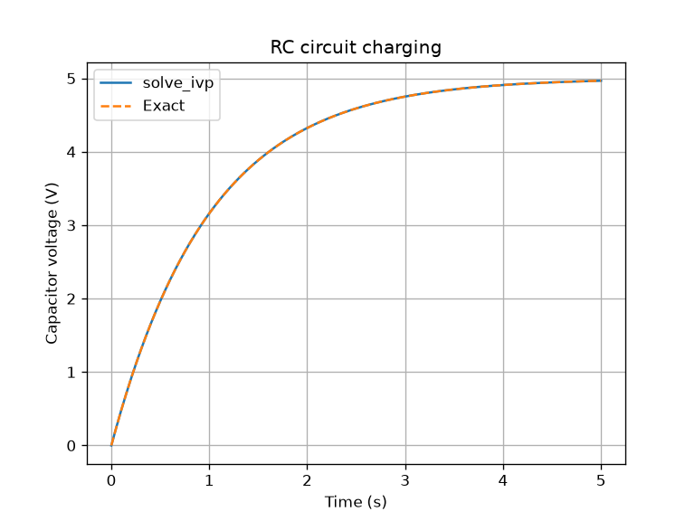
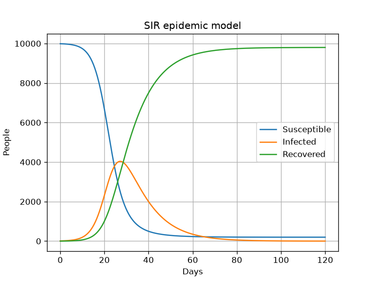

# Task 18: Numerical Solution of ODEs Using SciPy

Author: Kelvin Mein

## B. Inputs and mathematical operations
Inputs: an RC charging circuit with supply Vs = 5 V, R = 1000 ohms, C = 0.001 F, initial voltage 0 V, solved over 0 to 5 s.
Operations: scipy.integrate.solve_ivp solves dV/dt = (Vs - V)/(RC) with an adaptive step size (rtol 1e-9, atol 1e-11). The result is compared with the exact curve V = Vs(1 - e^(-t/RC)).

**Output (code/Task_18_scipy_ode.py):**
```
Solver success: True
Capacitor voltage at 5 s: 4.9663 V
Maximum error against exact solution: 9.282e-10 V
```



## C. Parameter change and effect
Changed the capacitance from 0.001 F to 0.002 F (code/Task_18_modified_parameter.py).

| | C = 0.001 F | C = 0.002 F |
|---|---|---|
| Time constant RC | 1 s | 2 s |
| Voltage at 5 s | 4.9663 V | 4.5896 V |
| Charge level at 5 s | 99.3% | 91.8% |
| Max error vs exact | 9.282e-10 V | 6.740e-10 V |

Doubling the capacitance doubled the time constant, so after the same 5 seconds the circuit is only 91.8% charged instead of 99.3%. A larger capacitor needs more charge to fill through the same resistor. By hand, 5(1 - e^-2.5) = 4.5896 V, which matches the solver. The solver stays accurate in both cases.

## D. Interpretation
The capacitor voltage rises quickly at first and then levels off towards the 5 V supply, because the charging current is proportional to the remaining voltage difference. The time constant RC = 1 s is the time to reach 63% of the final voltage. After 5 time constants the capacitor is 99.3% charged, giving 4.9663 V, which matches the hand calculation 5(1 - e^-5). The error of about 1e-9 V shows that solve_ivp agrees with the exact solution, and Solver success: True confirms it finished. On the graph the solver curve and the dashed exact curve lie on top of each other.

## E. Modified program: SIR epidemic model
Code: code/Task_18_modified_sir.py

Assumptions: a population of 10,000 with 10 initially infected; transmission rate beta = 0.4 per day and recovery rate gamma = 0.1 per day, so R0 = beta/gamma = 4; simulated for 120 days. The model is three coupled ODEs for susceptible (S), infected (I) and recovered (R) people.

**Output:**
```
Solver success: True
R0 = beta/gamma = 4.0
Peak infections: 4037 people on day 27.1
Total ever infected by day 120: 9802 (98.0 %)
Population conserved: max |S+I+R-N| = 7.28e-12
```



With R0 = 4, each infected person infects four others at the start, so the epidemic grows fast and peaks on day 27 with about 4037 people infected at once, roughly 40% of the population. The peak occurs when the susceptible count falls to N/R0 = 2500, after which each infected person infects fewer than one other and the epidemic declines. By day 120 about 98% of the population has been infected. The sum S + I + R stays at 10,000 to within 7e-12, so the solver preserves the total population. This is a system of ODEs that Euler's method could solve only with small steps, while solve_ivp chooses its steps automatically.