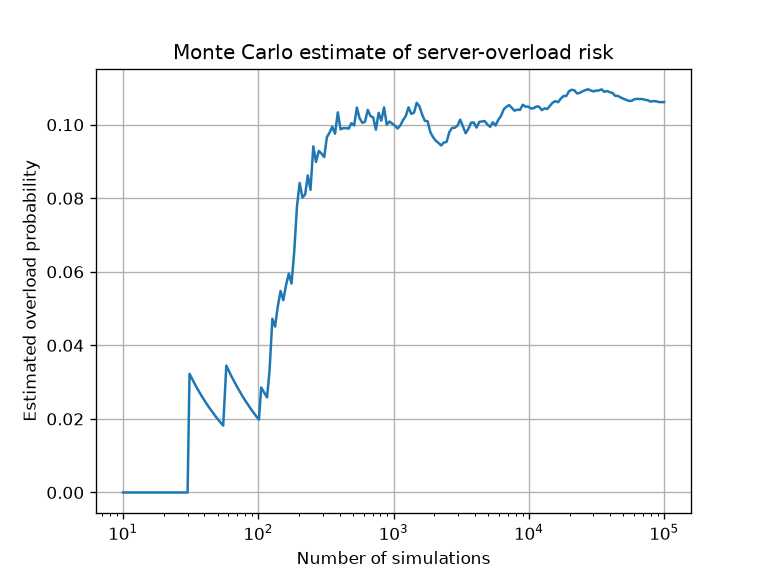
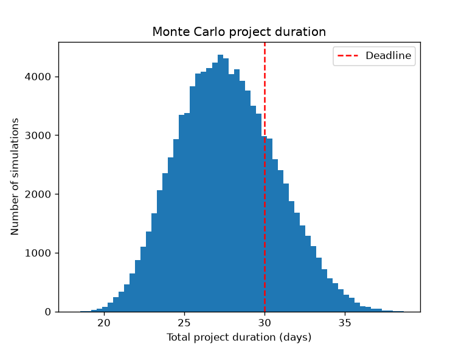

# Task 20: Random Numbers and Monte Carlo Methods

Author: Kelvin Mein

## B. Inputs and mathematical operations
Inputs: server capacity 1000, demand drawn from a normal distribution with mean 850 and standard deviation 120, N = 100,000 simulations, seed 42.
Operations: generate random demand scenarios with rng.normal, mark each scenario where demand exceeds capacity, and estimate the overload probability as the fraction of overloaded scenarios. A running average shows convergence.

**Output (code/Task_20_monte_carlo.py):**
```
Estimated overload probability: 10.6160%
Number of overload cases: 10616 out of 100000
```



By hand, capacity is (1000 - 850)/120 = 1.25 standard deviations above the mean, and the normal tail beyond 1.25 is about 10.56%.

## C. Parameter change and effect
Changed the mean demand from 850 to 900 (code/Task_20_modified_parameter.py).

| | Mean demand 850 | Mean demand 900 |
|---|---|---|
| z = (1000 - mean)/120 | 1.25 | 0.833 |
| Theory (normal tail) | about 10.56% | about 20.2% |
| Simulated probability | 10.6160% | 20.2210% |
| Overload cases (of 100,000) | 10,616 | 20,221 |

Raising the mean demand by about 6% nearly doubled the overload probability. The capacity now sits closer to the centre of the demand distribution, so more of the bell curve lies beyond it, and tail probabilities are very sensitive to the mean. The simulation agrees with theory within about 0.1 percentage points, which is the expected Monte Carlo noise for N = 100,000.

## D. Interpretation
The server is overloaded in about 10.6% of scenarios, roughly 1 in 9. The estimate agrees with the exact normal-tail value of 10.56%, and the difference is within the random error. For a probability near 0.106 with 100,000 samples, the standard error is about 0.001. The convergence graph wobbles when few simulations have been run and settles near 0.106 as the number grows, which shows that Monte Carlo accuracy improves with more samples, at a rate proportional to 1 over the square root of N. The method is useful when the probability cannot be worked out by a formula.

## E. Modified program: project-delay risk
Code: code/Task_20_modified_project_risk.py

Assumptions: three tasks in sequence with durations in days drawn from triangular distributions (min, most likely, max): Design (4, 6, 10), Build (10, 14, 22) and Test (3, 5, 9); the deadline is 30 days; seed 7; N = 100,000.

**Output:**
```
Most-likely total (sum of modes): 25 days
Simulated mean duration: 27.67 days
Simulated standard deviation: 3.05 days
Probability of finishing within 30 days: 77.21%
90th percentile duration: 31.77 days
Pi estimate from 100000 points: 3.1456 (true 3.1416)
```



The simulated mean of 27.67 days matches the hand calculation, since the mean of a triangular distribution is (min + mode + max)/3, giving 6.67 + 15.33 + 5.67. This is 2.67 days above the 25-day sum of the most likely values, because each distribution has a longer tail on the late side. Planning with the most likely values would therefore understate the delay. The project has a 77.21% chance of finishing within 30 days, so there is a 22.8% chance of missing the deadline, and in 1 simulation in 10 it takes longer than 31.77 days. The pi estimate of 3.1456 is within 0.004 of the true value, which is the size of error expected for 100,000 points and confirms the random generator behaves sensibly.
